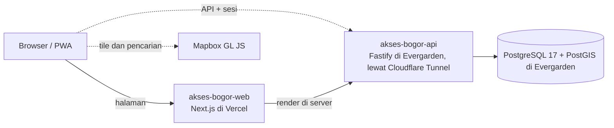

# Arsitektur

Sumber keputusan: [ADR-0013](https://github.com/al-dioooo/akses-bogor-docs/blob/main/decisions/0013-tech-stack-nextjs-fastify.md), [ADR-0025](https://github.com/al-dioooo/akses-bogor-docs/blob/main/decisions/0025-api-dan-postgresql-di-vps-sendiri.md), dan [ADR-0026](https://github.com/al-dioooo/akses-bogor-docs/blob/main/decisions/0026-api-dan-postgresql-di-evergarden-oci.md). Bagian yang direncanakan tetapi belum ada ditandai garis putus-putus.

- Web tidak pernah terhubung langsung ke database atau Cloudflare R2. Semua data lewat [akses-bogor-api](https://github.com/al-dioooo/akses-bogor-api).
- Halaman mengambil data dari API di server Next.js saat request (`src/lib/api.ts`, alamatnya di `API_URL`). Pengambilan data tidak di-cache dan tidak berjalan saat build, jadi build tidak butuh API. Bagian yang menunggu data dibungkus `Suspense` dengan kerangka pemuatan, dan galat API tampil sebagai pesan dengan tombol coba lagi.
- Peta dirender Mapbox GL JS di browser ([ADR-0016](https://github.com/al-dioooo/akses-bogor-docs/blob/main/decisions/0016-peta-dan-pencarian-mapbox.md)), dengan tampilan daftar sebagai alternatif yang setara.

## Bahasa

Teks antarmuka ada di `messages/id.json` dan dibaca lewat next-intl ([ADR-0020](https://github.com/al-dioooo/akses-bogor-docs/blob/main/decisions/0020-antarmuka-bahasa-indonesia-siap-i18n.md)). Locale `id` dan zona waktu `Asia/Jakarta` diatur di `src/i18n/config.ts`. Tidak ada routing per bahasa di MVP; menambah bahasa berarti menambah berkas pesan dan pemilih bahasa.

## Tampilan dan Gerak

- Mode warna mengikuti perangkat (Terang atau Gelap). Pengaturan tampilan di header bisa memaksa salah satunya lewat `<html data-theme>`, dan "Kurangi gerakan" memasang `<html data-motion="off">`. Pilihan disimpan di `localStorage` (`aksesbogor-tampilan`) dan dipasang oleh skrip kecil di `<head>` sebelum halaman digambar.
- Gerak memakai satu kurva (`ease-out-expo`): latar aurora bergeser pelan, kartu terangkat 2 px saat disorot, dan konten muncul saat digulir lewat scroll timeline CSS. Semuanya berhenti bila perangkat meminta gerak dikurangi atau `data-motion="off"`, dan konten tidak pernah disembunyikan bila browser tidak mendukung animasinya.
- Ikon berasal dari Tabler Icons (MIT) dan disalin sebagai path di `src/ui/icons.ts`, tanpa dependensi tambahan.

## Pengujian Aksesibilitas

Sesuai [ADR-0021](https://github.com/al-dioooo/akses-bogor-docs/blob/main/decisions/0021-wcag-22-aa-dan-pengujian-berlapis.md):

| Lapisan | Di repo ini |
| --- | --- |
| Lint | Aturan `jsx-a11y` strict di `eslint.config.mjs` |
| Tes otomatis | `e2e/a11y.spec.ts`: axe-core untuk WCAG 2.2 AA di ponsel dan desktop; pelanggaran serious atau critical menggagalkan CI |
| Tes perilaku | `e2e/*.spec.ts`: pencarian, filter, keadaan kosong dan galat, dan isi Detail, dengan data dari API tiruan |
| Setiap PR | Checklist aksesibilitas di template PR |
| Setiap rilis | Uji manual dengan TalkBack, NVDA, dan VoiceOver; di luar repo |

## Struktur Folder

| Folder | Isi |
| --- | --- |
| `src/app` | Route App Router, layout, `globals.css`, dan `tokens.css` hasil generator |
| `src/lib` | Klien API dan pembaca filter Jelajahi dari URL |
| `src/ui` | Komponen dasar: ikon, gaya tombol, Status badge, judul bagian, keadaan galat |
| `src/components` | Bagian halaman: header, Bottom nav, footer, pengaturan tampilan, dan isi tiap halaman |
| `design-tokens` | Snapshot ekspor variable Figma |
| `scripts` | Generator token dan skrip ekspor Figma |
| `src/i18n` | Konfigurasi next-intl |
| `messages` | Teks antarmuka per bahasa |
| `e2e` | Tes Playwright; `e2e/mock-api` berisi API tiruan dan datanya |
| `public` | Aset statis |
| `docs` | Dokumen ini |
