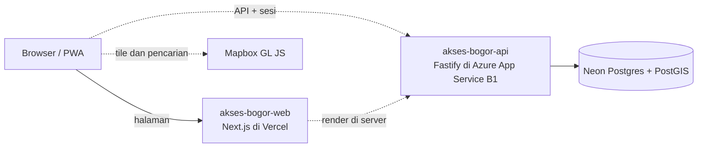

# Arsitektur

Sumber keputusan: [ADR-0013](https://github.com/al-dioooo/akses-bogor-docs/blob/main/decisions/0013-tech-stack-nextjs-fastify.md). Bagian yang direncanakan tetapi belum ada ditandai garis putus-putus.

- Web tidak pernah terhubung langsung ke database atau Cloudflare R2. Semua data lewat [akses-bogor-api](https://github.com/al-dioooo/akses-bogor-api).
- Peta dirender Mapbox GL JS di browser ([ADR-0016](https://github.com/al-dioooo/akses-bogor-docs/blob/main/decisions/0016-peta-dan-pencarian-mapbox.md)), dengan tampilan daftar sebagai alternatif yang setara.

## Bahasa

Teks antarmuka ada di `messages/id.json` dan dibaca lewat next-intl ([ADR-0020](https://github.com/al-dioooo/akses-bogor-docs/blob/main/decisions/0020-antarmuka-bahasa-indonesia-siap-i18n.md)). Locale `id` dan zona waktu `Asia/Jakarta` diatur di `src/i18n/config.ts`. Tidak ada routing per bahasa di MVP; menambah bahasa berarti menambah berkas pesan dan pemilih bahasa.

## Pengujian Aksesibilitas

Sesuai [ADR-0021](https://github.com/al-dioooo/akses-bogor-docs/blob/main/decisions/0021-wcag-22-aa-dan-pengujian-berlapis.md):

| Lapisan | Di repo ini |
| --- | --- |
| Lint | Aturan `jsx-a11y` strict di `eslint.config.mjs` |
| Tes otomatis | `e2e/a11y.spec.ts`: axe-core untuk WCAG 2.2 AA di ponsel dan desktop; pelanggaran serious atau critical menggagalkan CI |
| Setiap PR | Checklist aksesibilitas di template PR |
| Setiap rilis | Uji manual dengan TalkBack, NVDA, dan VoiceOver; di luar repo |

## Struktur Folder

| Folder | Isi |
| --- | --- |
| `src/app` | Route App Router, layout, `globals.css`, dan `tokens.css` hasil generator |
| `design-tokens` | Snapshot ekspor variable Figma |
| `scripts` | Generator token dan skrip ekspor Figma |
| `src/i18n` | Konfigurasi next-intl |
| `messages` | Teks antarmuka per bahasa |
| `e2e` | Tes Playwright |
| `public` | Aset statis |
| `docs` | Dokumen ini |
